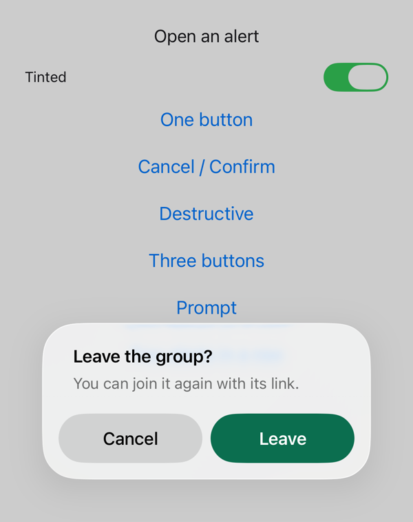
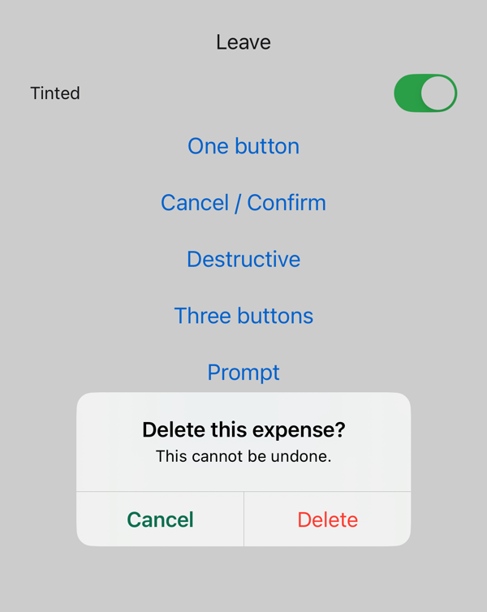
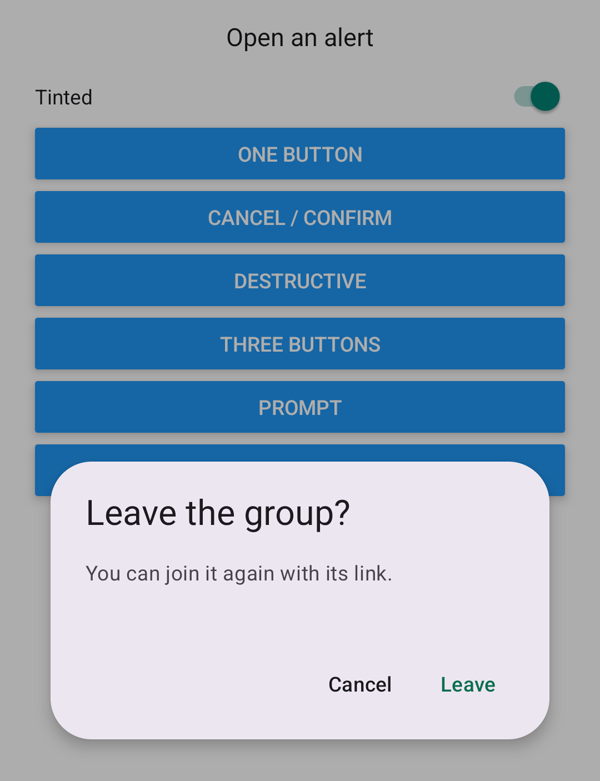
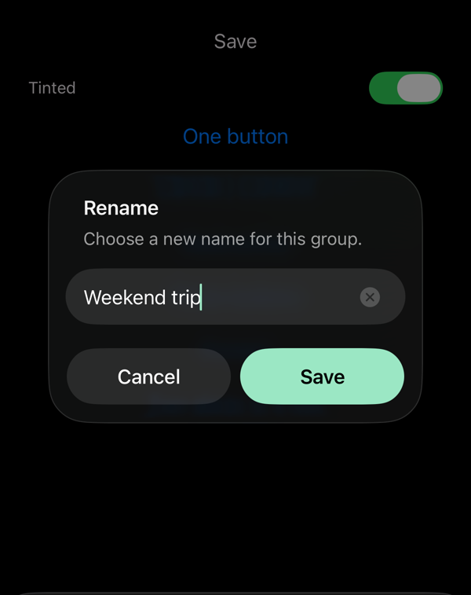
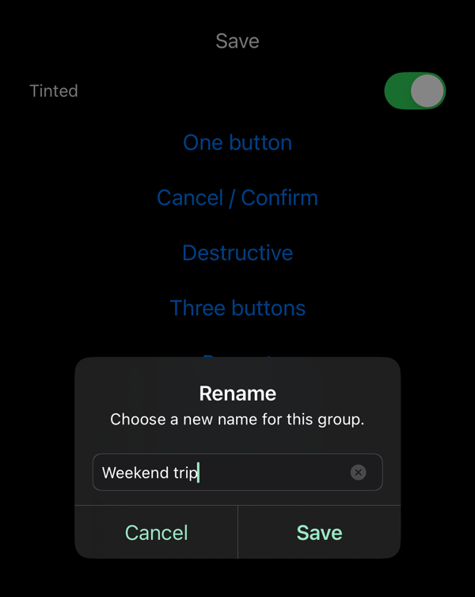
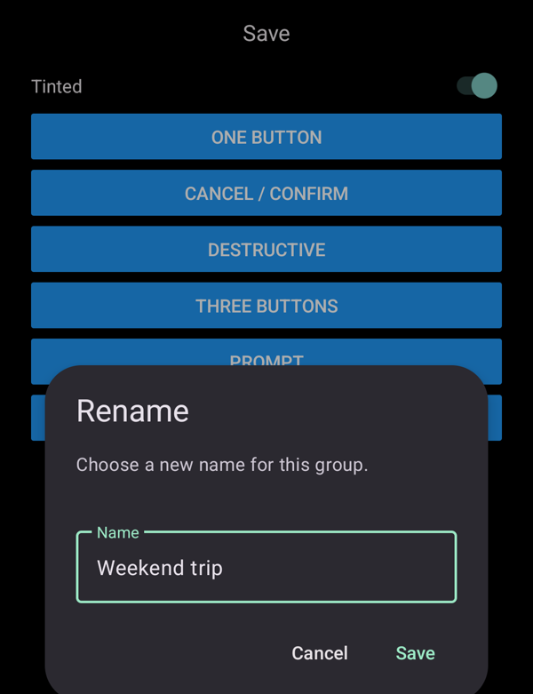

# @27appstudio/react-native-alert

Native alerts and text prompts for React Native, in your app's colors:

- **iOS**: `UIAlertController`, tinted. React Native's `Alert` always draws its buttons in the system blue. On iOS 26 the preferred button is filled with your tint, and gets a black label when the tint is light, so it stays readable in dark mode.
- **Android**: Material 3 dialogs (`MaterialAlertDialogBuilder`) instead of React Native's AppCompat ones. Default, cancel and destructive buttons each take their own color. The prompt is an outlined Material 3 text field in your tint.

| | iOS 26 | iOS 18 | Android |
|---|---|---|---|
| `alert` |  |  |  |
| `prompt`, dark mode |  |  |  |

It's a TurboModule with no views of its own in JS, no Expo modules, and no config plugin.

Made by [27AppStudio](https://github.com/27AppStudio) and used in production in [Splitify](https://splitify.cc).

## Installation

```sh
npm install @27appstudio/react-native-alert
cd ios && pod install
```

Requirements:

- React Native 0.82+ with the New Architecture
- **Android**: nothing more. The library ships `com.google.android.material:material` 1.13. Your app theme can stay AppCompat: dialogs are built with their own Material 3 theme (see [Android theme](#android-theme)).
- **Expo**: works in development builds, not in Expo Go.

## Usage

```ts
import { alert, prompt } from '@27appstudio/react-native-alert';

const colors = { tintColor: '#0B6E4F' };

alert(
  'Delete this expense?',
  'This cannot be undone.',
  [
    { text: 'Cancel', style: 'cancel' },
    { text: 'Delete', style: 'destructive', onPress: deleteExpense },
  ],
  colors
);

const name = await prompt({
  ...colors,
  title: 'Rename',
  defaultValue: group.name,
  label: 'Name',
  autoCapitalize: 'words',
  confirmText: 'Save',
});
if (name !== null) {
  rename(name);
}
```

`alert` takes the same arguments as React Native's `Alert.alert`, so you can swap it in without other changes.

Alerts are shown one at a time, in call order. An alert raised while another is on screen waits for it to close instead of replacing it.

## API

### `alert(title, message?, buttons?, options?)`

`buttons` defaults to a single **OK**. Each button has:

| Field | |
|---|---|
| `text` | |
| `onPress` | Called when the button closes the alert. |
| `style` | `'default'`, `'cancel'` or `'destructive'`. |
| `isPreferred` | iOS: the emphasized button. On iOS 26, it's filled with the tint. |

On Android, like React Native, only the last three buttons show: the last one is positive, the one before it negative, and the one before that neutral.

`options`:

| Option | |
|---|---|
| `tintColor` | `default` buttons. iOS: every button except destructive ones (iOS 26 draws cancel and other buttons in the label color). |
| `labelColor` | Android: `cancel` buttons. Defaults to the theme's button color. |
| `destructiveColor` | Android: `destructive` buttons. Defaults to the theme's `colorError`. iOS always uses its system red. |
| `cancelable` | Android: whether back or a tap outside dismisses the alert. Defaults to `false`, like React Native. |
| `onDismiss` | Android: called when the alert is dismissed without a button. |
| `userInterfaceStyle` | iOS: `'light'`, `'dark'` or `'unspecified'`. |

### `prompt(options): Promise<string | null>`

A one-field text prompt with a cancel and a confirm button. It resolves with the text as typed, or `null` when cancelled. The field is prefilled with `defaultValue` and focused. The confirm button is disabled while the field is blank, and the keyboard's Done key presses it.

| Option | |
|---|---|
| `title` | Required. |
| `message` | |
| `defaultValue` | Defaults to `''`. |
| `label` | Android: the field's floating label. |
| `autoCapitalize` | `'none'`, `'sentences'` (default), `'words'` or `'characters'`. |
| `cancelText`, `confirmText` | Default to `'Cancel'` and `'OK'`. |
| `tintColor` | The confirm button and the field (cursor; on Android the outline and label too). |
| `labelColor` | Android: the cancel button. |
| `cancelable` | Android: whether back or a tap outside cancels. Defaults to `true`. |
| `userInterfaceStyle` | iOS, as for `alert`. |

On Android, the field has `rn-alert-prompt-input` as its tag, so Detox's `by.id('rn-alert-prompt-input')` finds it.

### `isAvailable: boolean`

`false` where the native module is missing (web, Expo Go). There, `alert` falls back to React Native's `Alert` and `prompt` rejects.

## Android theme

Dialogs are built with the `Theme.RNAlert` style, a plain `Theme.Material3.DayNight.NoActionBar`. To change the surface and text colors, redefine it in your app's `android/app/src/main/res/values/styles.xml`; your app's resources win over the library's:

```xml
<style name="Theme.RNAlert" parent="Theme.Material3.DayNight.NoActionBar">
    <item name="colorSurfaceContainerHigh">@color/dialog_background</item>
    <item name="colorOnSurface">@color/label</item>
    <item name="colorOnSurfaceVariant">@color/secondary_label</item>
</style>
```

Button colors still come from JS when you pass them.

## Platform notes

- **iOS 26 preferred button**: the filled button's black label on a light tint is set through `UIAlertAction`'s private `titleTextColor` key, since there's no public API for it. If a future iOS drops the key, the label falls back to white and a warning is logged.
- **Several cancel buttons**: `UIAlertController` allows one. On iOS, like React Native, later `cancel` buttons are shown as `default` ones.

## Contributing

- [Development workflow](CONTRIBUTING.md#development-workflow)
- [Sending a pull request](CONTRIBUTING.md#sending-a-pull-request)
- [Code of conduct](CODE_OF_CONDUCT.md)

## License

MIT
